# Nhà 3D — ảnh chụp khung phòng trên điện thoại

Commit: `23d2d1a3c0dbc9df430bc3e6a8033dc032f87812` · 14 ảnh · đủ bộ

Ảnh do CI chụp tự động từ `/nha3d/multiroom-preview.html` (không Firebase, không mạng ngoài).
Đây là bằng chứng để người xem duyệt, **không phải** kết luận đạt/không đạt.
Cột “Hộp phòng chạm bảng” dùng hình chữ nhật bao quanh hộp 3D của phòng nên rộng hơn phòng thật; có tên bảng nghĩa là cần nhìn kỹ ảnh đó.

| Ảnh | Mô tả | Phòng | Màn hình | Hộp phòng chạm bảng | Lỗi trang |
| --- | --- | --- | --- | --- | --- |
| [360x844-khach.png](360x844-khach.png) | Phòng khách khi vừa mở | khach | 360×844 | — | — |
| [360x844-bep.png](360x844-bep.png) | Phòng bếp sau khi đi qua cửa | bep | 360×844 | — | — |
| [360x844-ngu.png](360x844-ngu.png) | Phòng ngủ sau khi đi qua cửa | ngu | 360×844 | — | — |
| [390x844-khach.png](390x844-khach.png) | Phòng khách khi vừa mở | khach | 390×844 | — | — |
| [390x844-bep.png](390x844-bep.png) | Phòng bếp sau khi đi qua cửa | bep | 390×844 | — | — |
| [390x844-ngu.png](390x844-ngu.png) | Phòng ngủ sau khi đi qua cửa | ngu | 390×844 | — | — |
| [430x844-khach.png](430x844-khach.png) | Phòng khách khi vừa mở | khach | 430×844 | — | — |
| [430x844-bep.png](430x844-bep.png) | Phòng bếp sau khi đi qua cửa | bep | 430×844 | — | — |
| [430x844-ngu.png](430x844-ngu.png) | Phòng ngủ sau khi đi qua cửa | ngu | 430×844 | — | — |
| [390x844-khach-ban-mo-phong.png](390x844-khach-ban-mo-phong.png) | Sau khi gọi bạn mô phỏng: chữ trạng thái dài hơn, nút đổi tên | khach | 390×844 | — | — |
| [844x390-khach-xoay-ngang.png](844x390-khach-xoay-ngang.png) | Xoay ngang điện thoại | khach | 844×390 | — | — |
| [390x844-khach-xoay-lai-doc.png](390x844-khach-xoay-lai-doc.png) | Xoay lại màn hình dọc | khach | 390×844 | — | — |
| [390x844-khach-lab-hai-tab.png](390x844-khach-lab-hai-tab.png) | Chế độ thí nghiệm hai tab: có thêm bảng trạng thái phía trên | khach | 390×844 | — | — |
| [360x640-khach-man-hinh-thap.png](360x640-khach-man-hinh-thap.png) | Điện thoại màn hình thấp 360×640 | khach | 360×640 | — | — |

## 360x844-khach.png

Phòng khách khi vừa mở

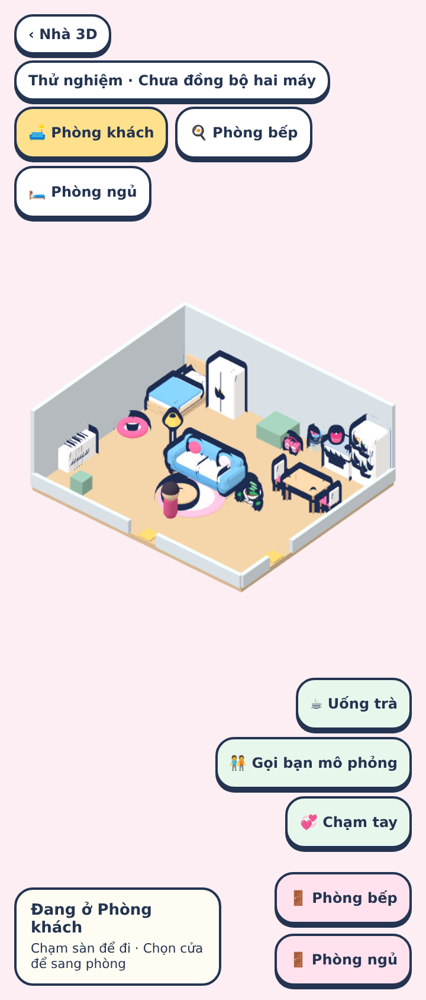

## 360x844-bep.png

Phòng bếp sau khi đi qua cửa

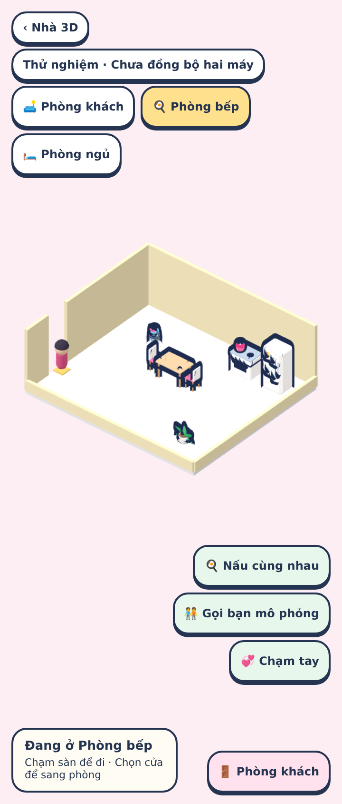

## 360x844-ngu.png

Phòng ngủ sau khi đi qua cửa

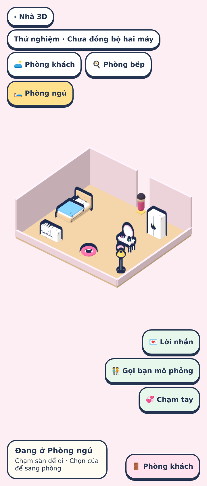

## 390x844-khach.png

Phòng khách khi vừa mở

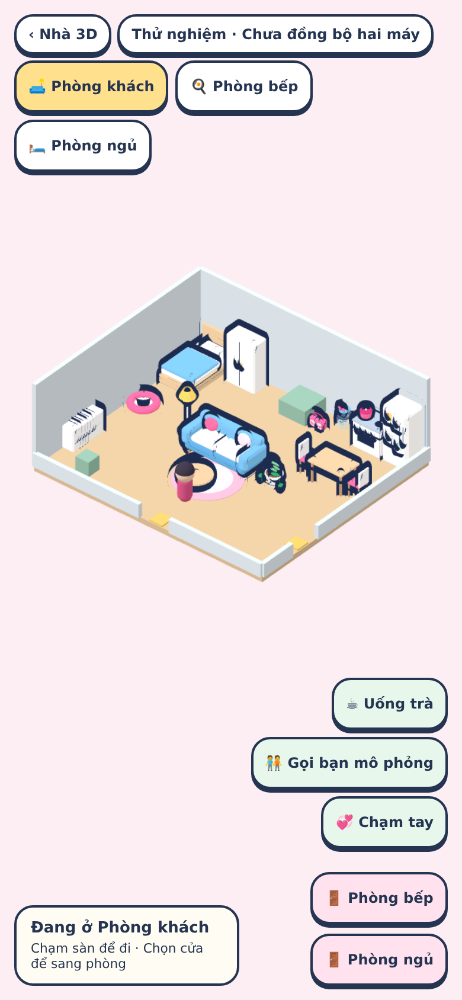

## 390x844-bep.png

Phòng bếp sau khi đi qua cửa

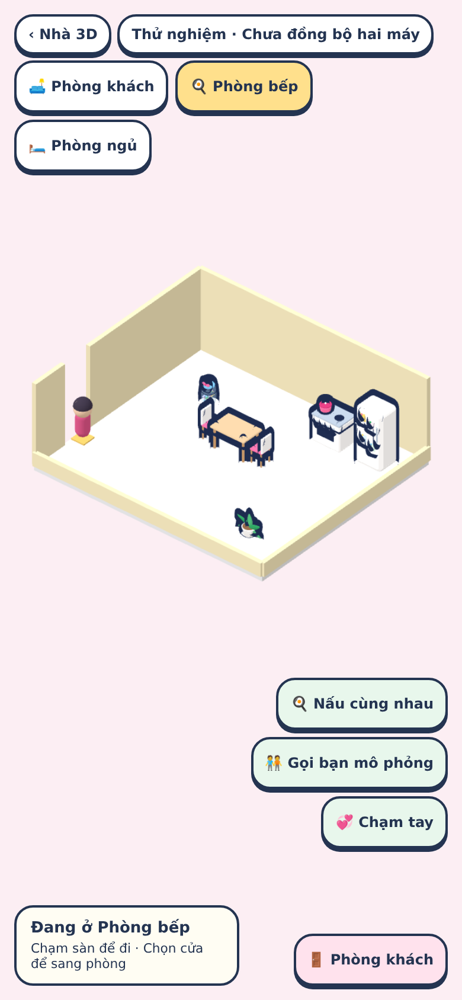

## 390x844-ngu.png

Phòng ngủ sau khi đi qua cửa

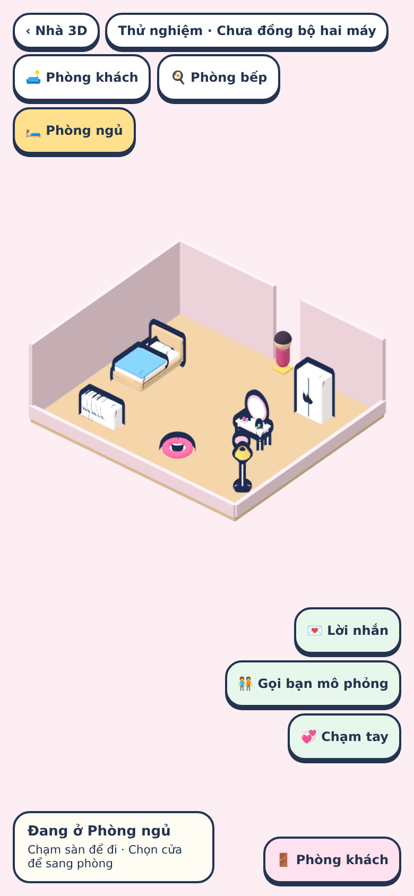

## 430x844-khach.png

Phòng khách khi vừa mở

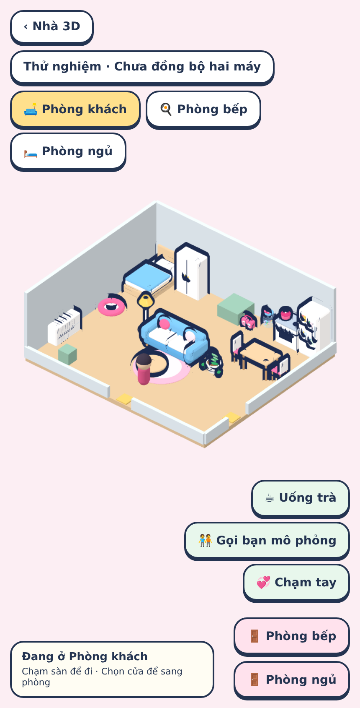

## 430x844-bep.png

Phòng bếp sau khi đi qua cửa

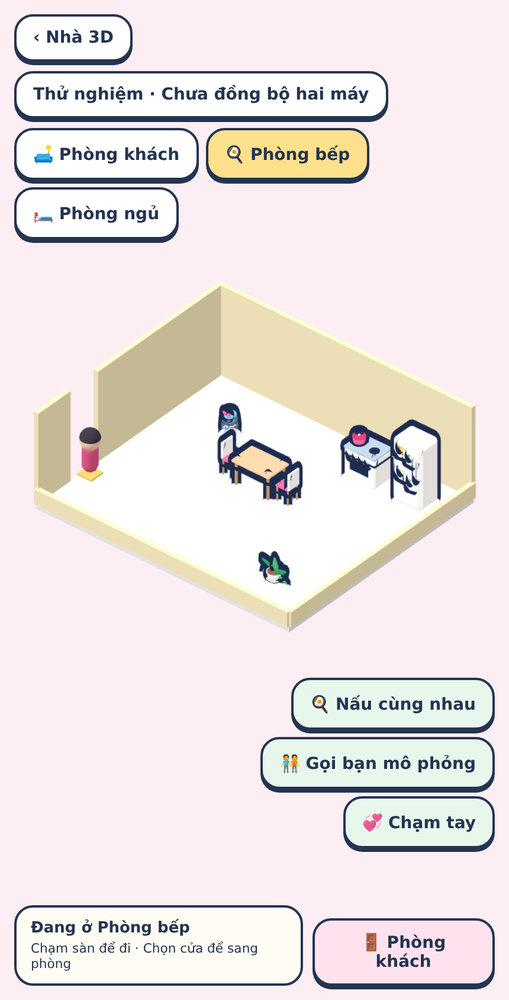

## 430x844-ngu.png

Phòng ngủ sau khi đi qua cửa

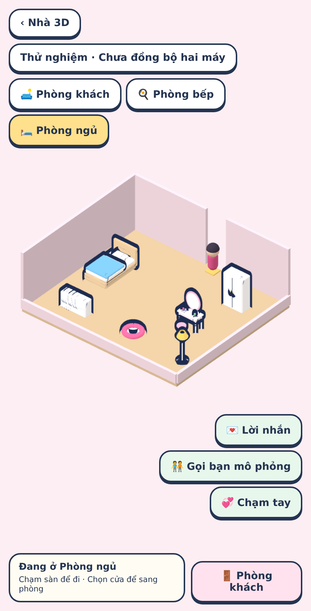

## 390x844-khach-ban-mo-phong.png

Sau khi gọi bạn mô phỏng: chữ trạng thái dài hơn, nút đổi tên

## 844x390-khach-xoay-ngang.png

Xoay ngang điện thoại

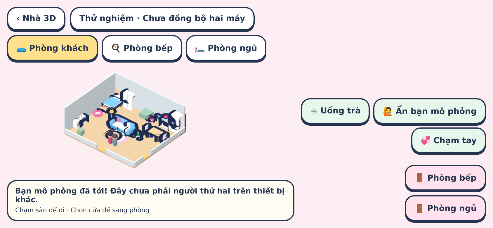

## 390x844-khach-xoay-lai-doc.png

Xoay lại màn hình dọc

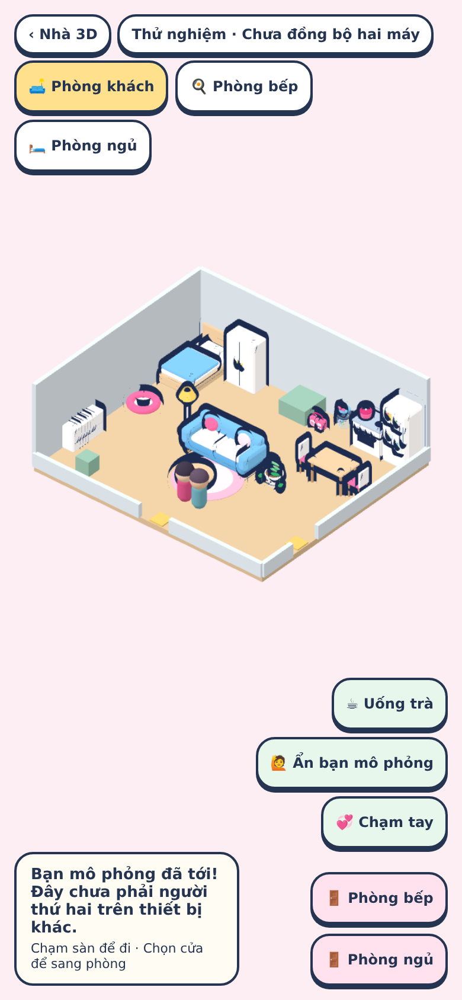

## 390x844-khach-lab-hai-tab.png

Chế độ thí nghiệm hai tab: có thêm bảng trạng thái phía trên

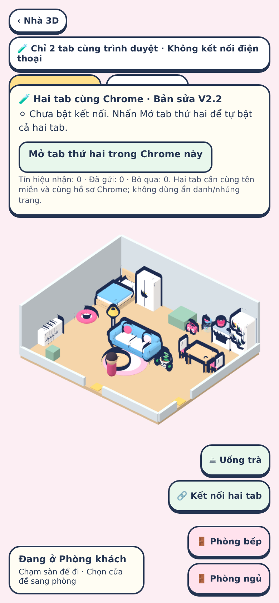

## 360x640-khach-man-hinh-thap.png

Điện thoại màn hình thấp 360×640

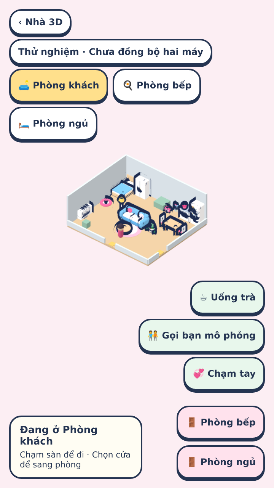
